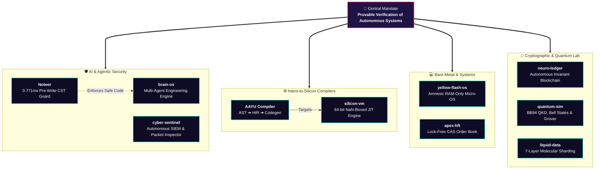

<div align="center">

<!-- ======================= HERO CYBER DEEP-TECH BANNER ======================= -->


<!-- Dynamic Typewriter HUD -->
<a href="https://git.io/typing-svg">
  
</a>

<br/><br/>

<!-- Holographic Command Badges -->
<p align="center">
  <a href="https://adumate.in"></a>
  <a href="https://x.com/o_Ayush_kaushik"></a>
  <a href="https://www.linkedin.com/in/ayushh-kaushiq-1a950825a"></a>
  <a href="https://youtube.com/@ayushkaushik08"></a>
  <a href="mailto:ayush@adumate.in"></a>
</p>

</div>

<br/>

<!-- ======================= REAL-TIME KERNEL TELEMETRY ======================= -->
```bash
  ╭──────────────────────────────────────────────────────────────────────────────────────────╮
  │ ⚡ DEEP-SILICON NODE // CORE KERNEL STATUS: ONLINE                                      │
  ├──────────────────────────────────────────────────────────────────────────────────────────┤
  │ OPERATOR      : Ayush Kaushik (Ghrit-igl) | Founder @ Adumate                            │
  │ CORE THESIS   : "Autonomous agents & runtimes break at boundary seams. I construct the   │
  │                 foundational silicon, compilers, and formal invariants before execution."│
  │ ACADEMIC BASE : B.Sc. Mathematics (Hons), BRABU ── Class of 2027                         │
  │ ACTIVE TARGETS: [●] AAYU (Intent-to-Silicon)  [●] Noteer AI Guard  [●] Yellow-Flash-OS   │
  ╰──────────────────────────────────────────────────────────────────────────────────────────╯
```

---

## 🏛️ Flagship Architectures & Defense Engines

<table border="0">
  <tr>
    <td width="50%" valign="top">
      <div align="left">
        <h3>🛡️ <a href="https://github.com/Ghrit-igl/Noteer">Noteer</a> </h3>
        <p><b>Pre-Execution AI Code Guard & Real-Time API Shield</b></p>
        <ul>
          <li><b>Sub-Millisecond CST Scan:</b> Median <code>0.771ms</code> parse latency via Tree-sitter CST analysis.</li>
          <li><b>Zero-Day Slopsquatting Defense:</b> Prevents hallucinated package hijack attacks in under 2ms before disk commit.</li>
          <li><b>Battle-Tested:</b> Meta Global AI Hackathon 2026 candidate with 270+ automated regression suites.</li>
        </ul>
        
        
        
      </div>
    </td>
    <td width="50%" valign="top">
      <div align="left">
        <h3>🧠 <a href="https://github.com/Ghrit-igl/INTENT-TO-SILICON">AAYU (Intent-to-Silicon)</a> </h3>
        <p><b>Systems Programming Language & Autonomous Silicon Runtime</b></p>
        <ul>
          <li><b>Dual Backend:</b> High-level IR lowered directly to native machine code via <b>LLVM</b> & <b>Cranelift</b>.</li>
          <li><b>Paired VM (<a href="https://github.com/Ghrit-igl/silicon-vm">silicon-vm</a>):</b> Custom bytecode virtual machine with 64-bit IEEE-754 NaN-boxing & register optimization.</li>
          <li>Deterministic sandbox execution built for next-generation AI agents.</li>
        </ul>
        
        
        
      </div>
    </td>
  </tr>
  <tr>
    <td width="50%" valign="top">
      <div align="left">
        <h3>⚡ <a href="https://github.com/Ghrit-igl/yellow-flash-os">yellow-flash-os</a> </h3>
        <p><b>Amnesic Volatile-RAM Live Micro-Operating System</b></p>
        <ul>
          <li><b>Zero Disk Trace:</b> Boots purely in volatile system memory without leaving forensic artifacts.</li>
          <li><b>Bare-Metal Architecture:</b> Engineered on x86_64, Limine Protocol bootloader & QEMU hardware emulation.</li>
          <li>Integrated with the AAYU execution runtime sandbox.</li>
        </ul>
        
        
        
      </div>
    </td>
    <td width="50%" valign="top">
      <div align="left">
        <h3>🔬 <a href="https://github.com/Ghrit-igl/KoeeO">KoeeO</a> & <a href="https://github.com/Ghrit-igl/apex-hft">apex-hft</a> </h3>
        <p><b>Tony Stark Virtual Lab & Nanosecond Low-Latency Engine</b></p>
        <ul>
          <li><b>KoeeO:</b> Holographic 3D WebGL simulator rendering interactive experiments over the AAYU kernel.</li>
          <li><b>apex-hft:</b> Nanosecond lock-free in-memory Limit Order Book (LOB) with CAS interning matching engine.</li>
        </ul>
        
        
        
      </div>
    </td>
  </tr>
</table>

---

## 🔮 Deep-Tech Ecosystem Topology



---

## 🎛️ Weapons & Technology Stack

<div align="center">

| Layer | Specialization & Tooling |
|:---|:---|
| **Low-Level & Hardware** | `Rust` `C / C++` `x86_64 Assembly` `LLVM IR` `Cranelift` `QEMU` `Limine Protocol` |
| **Compiler & Runtimes** | `Tree-sitter (CST)` `Bytecode VMs` `NaN-Boxing` `AST Lowering` `JIT Compilation` |
| **AI Systems & Security** | `Meta Llama 3.3` `PyTorch` `DPoP (RFC 9449)` `Autonomous Agents` `SIEM Packet Inspection` |
| **Interactive & Web3** | `React 19` `TypeScript` `Three.js / WebGL` `EVM Invariants` `Quantum Circuit Logic` |
| **Mathematical Domain** | `Abstract Algebra` `Formal Invariant Testing` `Bell States & Grover Search` `Cryptography` |

<br/>


</div>

---

## 🏆 Cyberpunk Trophy Vault

<div align="center">
  
</div>

---

## 📡 Live Cyber Activity & Neon Snake Animation

<div align="center">

<!-- Glowing Snake Animation -->
<picture>
  <source media="(prefers-color-scheme: dark)" srcset="https://raw.githubusercontent.com/Ghrit-igl/Ghrit-igl/output/github-contribution-grid-snake-dark.svg">
  <source media="(prefers-color-scheme: light)" srcset="https://raw.githubusercontent.com/Ghrit-igl/Ghrit-igl/output/github-contribution-grid-snake.svg">
  
</picture>

<br/><br/>

<!-- Realtime Streak & Stats Cards -->
<a href="https://git.io/streak-stats">
  
</a>
<a href="https://github.com/anuraghazra/github-readme-stats">
  
</a>
<a href="https://github.com/anuraghazra/github-readme-stats">
  
</a>

</div>

---

## 🚀 Founder & Research Broadcasts

* ⚡ **[Adumate](https://adumate.in)** — Founder. Building autonomous AI API rotation, multi-model fallback clustering, and microsecond service discovery.
* 🎙️ **[How Computers Think — Zero to Research](https://youtube.com/@ayushkaushik08)** — High-bandwidth deep-tech masterclasses from logic gate cascades to neural inference hardware.

<br/>

<div align="center">
  <sub>Engineered for the 2026 Deep-Tech Frontier · Zero Fluff, 100% Mathematical & Systems Rigor</sub>
  <br/><br/>
  
</div>
