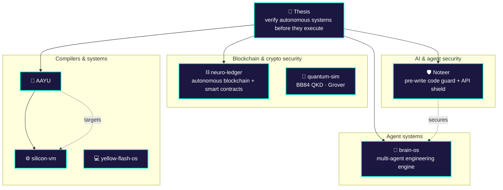
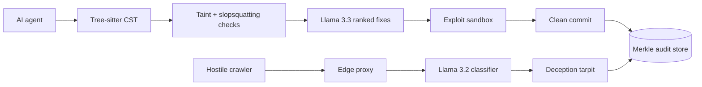
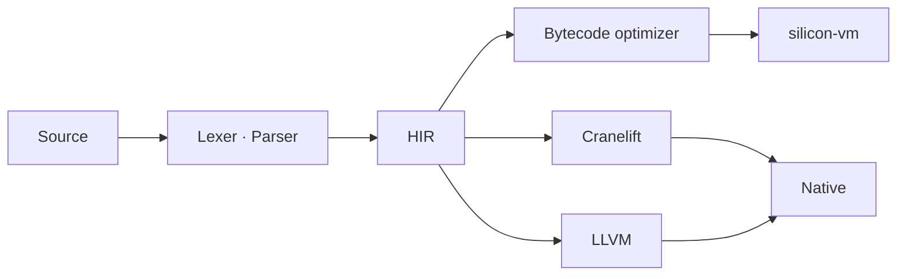
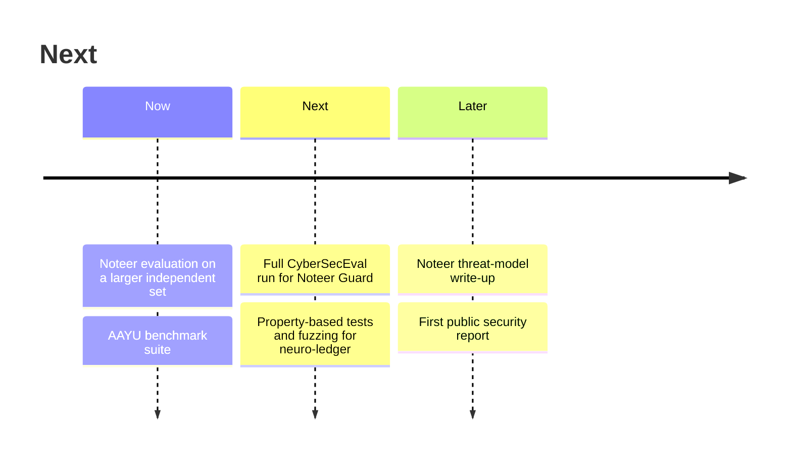

<div align="center">


<br/><br/>

<a href="https://adumate.in"></a>
<a href="https://www.linkedin.com/in/ayushh-kaushiq-1a950825a"></a>
<a href="https://youtube.com/@ayushkaushik08"></a>
<a href="https://x.com/o_Ayush_kaushik"></a>

</div>

<br/>

```console
ayush@silicon:~$ whoami
Ayush Kaushik — founder @ Adumate · AI systems architect · security researcher

ayush@silicon:~$ cat thesis.txt
 Autonomous systems (AI agents, blockchains, runtimes) fail at the seams.
 I build the infrastructure from scratch and verify it before it executes.

ayush@silicon:~$ cat research_areas.txt
 [1] AI-code & agent security      stop unsafe agent output before it lands
 [2] Blockchain & crypto security  invariants · consensus · smart-contract safety
 [3] Compilers & VMs               language design · IR · bytecode · codegen
 [4] Autonomous agent systems      multi-agent engineering · orchestration

ayush@silicon:~$ status
 ● shipped    Noteer → Meta Global AI Developer Hackathon 2026 (submitted)
 ● building   Noteer evaluation write-up · AAYU benchmarks
 ● studying   B.Sc. Mathematics (Hons), BRABU · exp. 2027
```

---

## 🧭 Research map


<sub>Edit the arrows to match your real dependencies.</sub>

---

## 🛡️ Flagship — [Noteer](https://github.com/Ghrit-igl/Noteer)
### Dual-pillar AI security: guard code at write time, defend APIs at runtime

<div align="center">


</div>

**Problem.** AI coding agents write unreviewed code straight to disk, and models hallucinate package names that attackers can register ("slopsquatting", USENIX Security 2025). Autonomous crawlers also harvest proprietary APIs.



| Pillar | Metric | Result | Scope |
|:--|:--|--:|:--|
| Guard | CST scan latency, median / P95 | **0.771 ms / 1.583 ms** | Tree-sitter parse |
| Guard | Insecure rate on bundled demo cases | **100% → 0%** | Sandbox-verified, *not* full CyberSecEval |
| Shield | Precision / recall / F1 | **100% / 100% / 1.000** | **24 labeled sessions**, in-house testbench |
| Shield | Proprietary fields leaked | **0** | Schema minimization + honeypot |
| Shield | Edge proxy P50 latency | **9.61 ms** | Live HTTP testbench |

<sub>Shield results come from a small self-built session set. Next: larger independent evaluation + full CyberSecEval run.</sub>

`Python` `TypeScript` `Tree-sitter` `Meta Llama 3.2 / 3.3` `DPoP (RFC 9449)` `Docker`

---

## ⛓️ Blockchain & crypto security

| Project | What it is | Verification evidence |
|:--|:--|:--|
| [neuro-ledger](https://github.com/Ghrit-igl/neuro-ledger) | Single-file autonomous blockchain with smart contracts | `<property tests / fuzzing / invariants checked: list them>` |
| [quantum-sim](https://github.com/Ghrit-igl/quantum-sim) | Quantum circuit simulator: Bell states, Grover, BB84 QKD | `<test against known analytical results>` |
| [cyber-sentinel](https://github.com/Ghrit-igl/cyber-sentinel) | Autonomous SIEM and packet inspector | `<benchmark / test method>` |

**Security approach:** threat-model first → state the invariants → test them (property-based + fuzzing) → publish the evidence.

<!-- UNCOMMENT WHEN YOU HAVE REAL, PUBLIC REPORTS (audits, contests, bounties, CVEs, CTFs):

### Security research log
| Target | Scope | Category | Result | Report |
|:--|:--|:--|:--|:--:|
| `<protocol>` | `<contracts>` | Audit / Contest / Bounty / CVE | `<severity or rank>` | [link](...) |

Profiles: [Code4rena](...) · [Sherlock](...) · [Cantina](...) · [Immunefi](...)
-->

---

## 🤖 AI systems architecture

| Project | Architecture |
|:--|:--|
| [brain-os](https://github.com/Ghrit-igl/brain-os) | Autonomous multi-agent software-engineering engine. `<agents · orchestration · eval results>` |
| [Noteer](https://github.com/Ghrit-igl/Noteer) | Guard layer for agent output (above) |

---

## ⚙️ Compilers & systems



| Project | Role | Evidence |
|:--|:--|:--|
| [AAYU / Intent-to-Silicon](https://github.com/Ghrit-igl/INTENT-TO-SILICON) | Systems language in Rust | `<what compiles today · benchmark vs baseline>` |
| [silicon-vm](https://github.com/Ghrit-igl/silicon-vm) | Bytecode VM, 64-bit NaN-boxing | `<test count · benchmark>` |
| [yellow-flash-os](https://github.com/Ghrit-igl/yellow-flash-os) | Amnesic RAM-only micro-OS (x86_64, Limine, QEMU) | `<boot screenshot>` |

---

## 🚀 Founder

**[Adumate](https://adumate.in)** — AI API rotation and service-discovery platform.
`<users / uptime / requests handled — only real numbers>`

**Teaching:** [How Computers Think — Zero to Research](https://youtube.com/@ayushkaushik08), from silicon gates to neural architectures.

---

<!-- UNCOMMENT WHEN YOU HAVE WRITING / PAPERS:

## 📝 Research notes
| Title | Topic | Link |
|:--|:--|:--|
| `<Noteer evaluation>` | AI-code security | [link](...) |
-->

## 🗺️ Roadmap



---

## 📡 Live activity <sub>(auto-updated)</sub>

<!--START_SECTION:activity-->
<!--END_SECTION:activity-->

<details>
<summary><b>🎓 Background</b></summary>

<br/>

B.Sc. Mathematics (Hons), BRABU, expected 2027 · self-taught in systems programming and ML.

</details>

<details>
<summary><b>🤝 Open to</b></summary>

<br/>

AI-security research collaboration · blockchain security · compilers and VMs.
📧 `<your public email>`

</details>

<br/>


