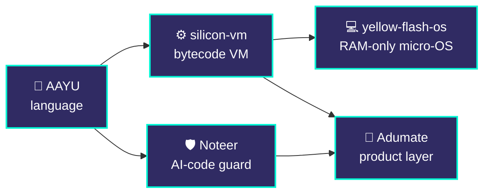

<!-- ═══════════════════════ HEADER ═══════════════════════ -->
<div align="center">


<a href="https://github.com/Ghrit-igl">
  
</a>

<br/>

<a href="https://adumate.in"></a>
<a href="https://www.linkedin.com/in/ayushh-kaushiq-1a950825a"></a>
<a href="https://youtube.com/@ayushkaushik08"></a>
<a href="https://x.com/o_Ayush_kaushik"></a>

</div>

<br/>

<!-- ═══════════════════════ WHOAMI ═══════════════════════ -->
```console
ayush@silicon:~$ whoami
Ayush Kaushik — systems & AI-security engineer, founder @ Adumate

ayush@silicon:~$ cat focus.txt
[1] Compilers & VMs      language design · IR · bytecode · codegen
[2] AI-code security     stop unsafe agent output BEFORE it touches disk
[3] Low-level systems    boot · memory · isolation

ayush@silicon:~$ cat philosophy.txt
Build the infrastructure from scratch. Then build products on top of it.

ayush@silicon:~$ status
● building   Noteer eval write-up · AAYU benchmarks
```

---

## 🧭 How my projects connect



> One stack, built bottom-up: **language → runtime → OS → security → product.**

---

## 🔬 Selected work

<table>
<tr>
<td width="50%" valign="top">

### 🛡️ [Noteer](https://github.com/Ghrit-igl/Noteer)
**Pre-write guard for AI coding agents**

Agents write unreviewed code straight to disk. Noteer intercepts it first.

```
agent output
   ↓  Tree-sitter CST
   ↓  taint analysis
   ↓  verdict
write  ✅  /  block  ⛔
```

`Python` `Tree-sitter` `DPoP (RFC 9449)`

**Eval:** `<detection rate> · <false-positive rate> · <dataset>`
**Meta Global AI Developer Hackathon 2026:** `<submitted / result>`

</td>
<td width="50%" valign="top">

### 🧠 [AAYU / Intent-to-Silicon](https://github.com/Ghrit-igl/INTENT-TO-SILICON)
**Systems language in Rust**

```
source → lexer → parser → HIR
       → bytecode optimizer
       → Cranelift / LLVM
```

`Rust` `LLVM` `Cranelift`

**Status:** `<what compiles and runs today>`
**Bench:** `<workload · baseline · result>`

</td>
</tr>
<tr>
<td width="50%" valign="top">

### ⚙️ [silicon-vm](https://github.com/Ghrit-igl/silicon-vm)
**Bytecode VM · NaN-boxed 64-bit values**

| Benchmark | Result |
|:--|--:|
| `<fib(35)>` | `<ms>` |
| `<loop 1e8>` | `<ms>` |

`Rust` · JIT: `<status>`

</td>
<td width="50%" valign="top">

### 💻 [yellow-flash-os](https://github.com/Ghrit-igl/yellow-flash-os)
**Amnesic live micro-OS · runs fully in RAM**

x86_64 · Limine bootloader · QEMU

Boots: `<yes / screenshot>`
Implemented: `<paging · shell · ...>`

`Assembly` `C` `Python`

</td>
</tr>
</table>

---

## 🧰 Stack

<div align="center">


</div>

---

## 📡 Currently

| | |
|:--|:--|
| 🔨 **Building** | Noteer evaluation write-up, AAYU benchmark suite |
| 📚 **Studying** | B.Sc. Mathematics (Hons), BRABU · exp. 2027 |
| 🎬 **Teaching** | [How Computers Think — Zero to Research](https://youtube.com/@ayushkaushik08) |

<details>
<summary><b>🗺️ Roadmap (click to expand)</b></summary>

<br/>

- [ ] Noteer: publish evaluation + threat model
- [ ] AAYU: public benchmark table vs baselines
- [ ] silicon-vm: JIT tier
- [ ] yellow-flash-os: documented boot sequence

</details>

<details>
<summary><b>📬 Contact</b></summary>

<br/>

Open to collaborations on compilers, VMs and AI-code security.
📧 `<your public email>`

</details>

<br/>


