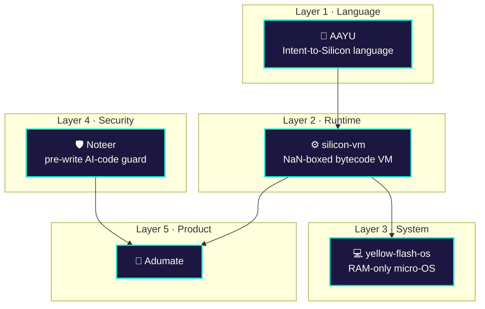
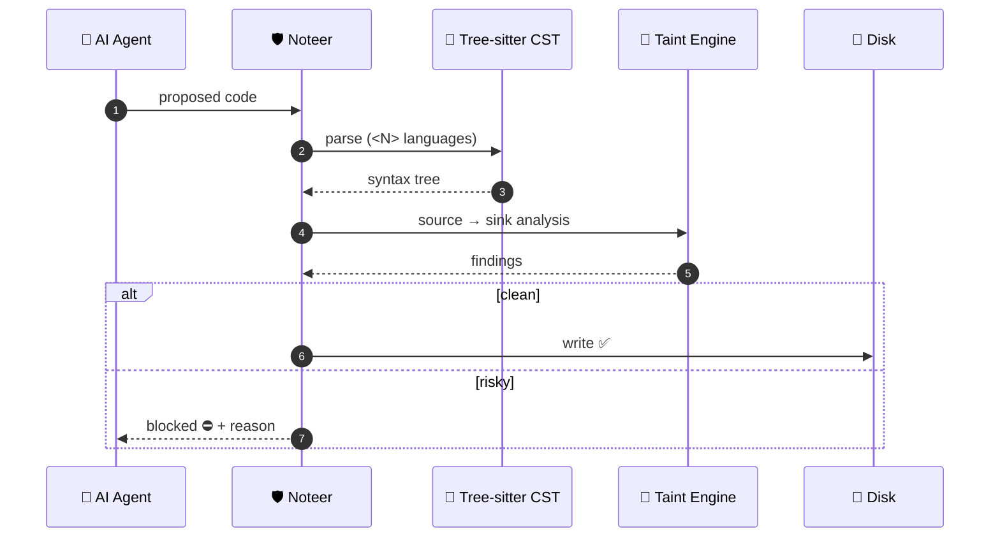
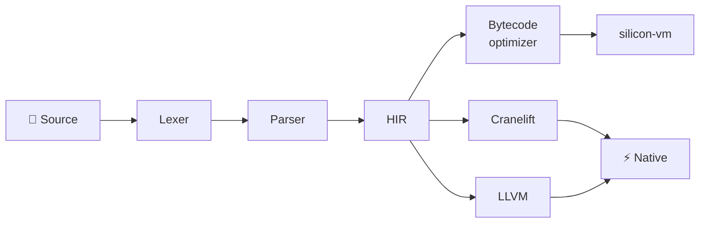
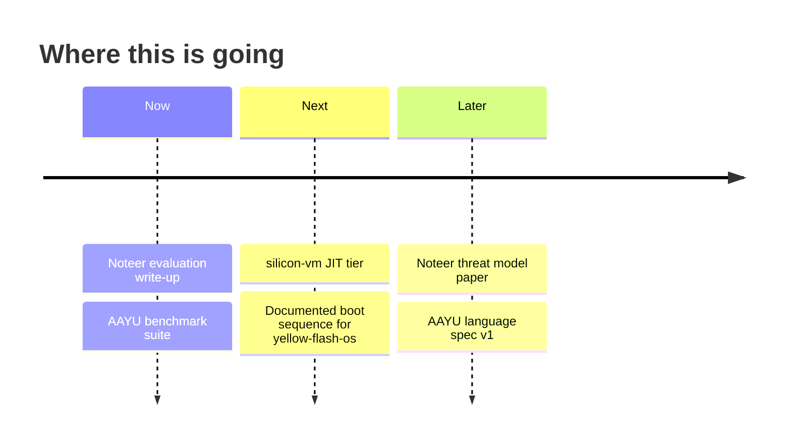

<!-- ═══════════════════════════ HERO ═══════════════════════════ -->
<div align="center">


<br/><br/>

<a href="https://adumate.in"></a>
<a href="https://www.linkedin.com/in/ayushh-kaushiq-1a950825a"></a>
<a href="https://youtube.com/@ayushkaushik08"></a>
<a href="https://x.com/o_Ayush_kaushik"></a>

<br/><br/>


</div>

<br/>

<!-- ═══════════════════════════ TERMINAL ═══════════════════════════ -->
```console
ayush@silicon:~$ whoami
Ayush Kaushik — systems & AI-security engineer · founder @ Adumate

ayush@silicon:~$ cat research_agenda.txt
 [1] Compilers & VMs       language design · HIR · bytecode · JIT · codegen
 [2] AI-code security      block unsafe agent output BEFORE it touches disk
 [3] Low-level systems     boot · paging · memory isolation · amnesic OS
 [4] Verification          taint flows · invariants · formal checks

ayush@silicon:~$ cat philosophy.txt
 Build the infrastructure from scratch.
 Then build the product on top of it.

ayush@silicon:~$ status
 ● building   Noteer evaluation · AAYU benchmark suite
 ● studying   B.Sc. Mathematics (Hons), BRABU · exp. 2027
 ● teaching   How Computers Think — Zero to Research (YouTube)
```

---

## 🧭 The stack, bottom-up



<sub>Edit the arrows to match your real dependencies. A wrong diagram is worse than none.</sub>

---

## 🔬 Flagship #1 — [Noteer](https://github.com/Ghrit-igl/Noteer)
### Pre-write security gate for AI coding agents

**Problem.** Coding agents write code to disk before anyone reviews it. That code can contain injection paths, unsafe calls and hallucinated packages.
**Approach.** Intercept the agent's output, parse it into a CST, run taint analysis, and only then allow the write.



| Metric | Result | Dataset / Method |
|:--|:--:|:--|
| Detection rate | `<%>` | `<dataset>` |
| False-positive rate | `<%>` | `<dataset>` |
| Latency per file | `<ms>` | `<hardware>` |
| Languages | `<N>` | Tree-sitter grammars |

**Built for:** Meta Global AI Developer Hackathon 2026 · Result: `<submitted / placed>`
`Python` `Tree-sitter` `DPoP (RFC 9449)` `Llama`

---

## ⚙️ Flagship #2 — [AAYU / Intent-to-Silicon](https://github.com/Ghrit-igl/INTENT-TO-SILICON)
### A systems language in Rust



```text
// <paste a REAL 6–10 line AAYU snippet here. Code speaks louder than adjectives.>
```

| Benchmark | AAYU | Baseline | Notes |
|:--|:--:|:--:|:--|
| `<fib(35)>` | `<ms>` | `<Python/Lua ms>` | `<machine>` |
| `<loop 1e8>` | `<ms>` | `<…>` | `<…>` |

**Status:** `<what compiles and runs today, plainly>`

---

## 🧱 More systems work

<table>
<tr>
<td width="50%" valign="top">

### [silicon-vm](https://github.com/Ghrit-igl/silicon-vm)
64-bit IEEE-754 **NaN-boxing**, bytecode VM in Rust.
JIT: `<status>` · Tests: `<N>`

`Rust`

</td>
<td width="50%" valign="top">

### [yellow-flash-os](https://github.com/Ghrit-igl/yellow-flash-os)
Amnesic **volatile-RAM** live micro-OS. x86_64, Limine, QEMU.
Boots: `<yes + screenshot>` · Implemented: `<paging / shell / …>`

`Assembly` `C` `Python`

</td>
</tr>
<tr>
<td width="50%" valign="top">

### [aayu-mobile-ide](https://github.com/Ghrit-igl/aayu-mobile-ide)
Touch-first web IDE for AAYU. React 19 · TypeScript · Monaco.

`TypeScript` `PWA`

</td>
<td width="50%" valign="top">

### [portfolio](https://github.com/Ghrit-igl/portfolio)
Interactive 3D portfolio. React 19 · Three.js · Vite.

`TypeScript` `Three.js`

</td>
</tr>
</table>

---

## 🧰 Toolbox

<div align="center">


</div>

---

## 🗺️ Roadmap



---

## 📡 Live activity <sub>(auto-updated)</sub>

<!--START_SECTION:activity-->
<!--END_SECTION:activity-->

<div align="center">


</div>

---

<details>
<summary><b>🎓 Background</b></summary>

<br/>

- B.Sc. Mathematics (Hons), BRABU — expected 2027
- Self-taught in systems programming and ML
- Creator of the YouTube series *How Computers Think — Zero to Research*

</details>

<details>
<summary><b>🤝 Open to</b></summary>

<br/>

Collaboration on compilers, VMs, AI-code security and verification.
📧 `<your public email>`

</details>

<br/>


